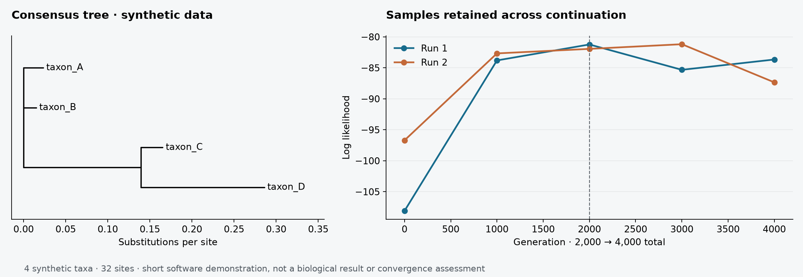

# Cladistica 0.2.0

Cladisticaは、植物のDNAマーカーを対象に、GenBankアクセッションの確認、自分のFASTA配列との統合、アラインメント、連結、系統樹推定を実行するコマンドラインツールです。MUSCLEが配列を整列し、IQ-TREEが最尤法（ML）、MrBayesがベイズ法（BI）の解析を担当します。各工程は個別にも実行できます。

[ダウンロード](https://github.com/yoneoka-katsuhiro/Cladistica/releases) · [English](README.md) · [日本語マニュアル](docs/MANUAL.ja.md) · [English manual](docs/MANUAL.en.md) · [変更履歴](CHANGELOG.md)



*同梱の32塩基・4分類群の人工配列を2,000世代解析した後、チェックポイントから4,000世代まで継続した実出力です。この短い例は再開処理を確認するためのもので、生物学的な結果やMCMC収束の証拠ではありません。*

## ダウンロードと起動

[Releases](https://github.com/yoneoka-katsuhiro/Cladistica/releases)から対象OSのZIPを選び、フォルダ全体を展開してください。`_internal`フォルダを実行ファイルの隣に置き、ターミナルから実行します。デスクトップ画面は開きません。

| 配布ファイル | 対象 | 内容 |
| --- | --- | --- |
| `Cladistica-0.2.0-macOS-arm64.zip` | Apple Silicon Mac | 本体、Python実行環境、例題、英日マニュアル |
| `Cladistica-0.2.0-Windows-x64.zip` | Windows x64 | 本体、Python実行環境、例題、英日マニュアル |

macOS版は未公証、Windows版はAuthenticode未署名です。各配布物のビルド・検証状況はリリースページに記載します。Windowsの自動テストは、外部解析ソフトを含む全工程の実機確認を意味しません。Intel MacではPythonから利用できます。

**macOS:** `./cladistica --help`
**Windows PowerShell:** `.\cladistica.exe --help`

**MUSCLE・IQ-TREE・MrBayesは別途インストールしてください。** `--muscle`、`--iqtree`、`--mrbayes`に実行ファイルのパスを指定できます。解析を実行しない`--dry-run`には、これらの外部ソフトは不要です。[導入手順](docs/MANUAL.ja.md#導入)も参照してください。

ソースから利用する場合は、このリポジトリをダウンロードしてフォルダを開き、Python 3.10以降で次を実行します。

```bash
python -m venv .venv
# macOS/Linux: source .venv/bin/activate
# Windows PowerShell: .venv\Scripts\Activate.ps1
python -m pip install .
cladistica --help
```

## 基本的な使い方

1. `survey`でGenBankの候補を集め、`accession_all.csv`の標本情報、voucher、領域、配列長を確認します。
2. 1標本1行、各マーカー1アクセッションの`accession_selected.csv`を作ります。同じ標本には全マーカーを通じて同じ`sample_id`を付けてください。
3. `resume`で配列を取得し、自分のマーカーFASTAを追加して、整列・連結・系統樹推定を実行します。
4. アラインメントのQC、ML支持値、独立BI runのトレース、ESS、収束診断を確認してから系統樹を解釈します。

同梱例題でBIの継ぎ足しを確認できます。

```bash
cladistica resume --concatenated-fasta examples/tiny.fasta --output demo_run --skip-ml --ngen 2000
cladistica resume-bi --bundle demo_run --output demo_extended --ngen 4000
```

配布版では先頭の`cladistica`を、macOSでは`./cladistica`、PowerShellでは`.\cladistica.exe`に置き換えます。この例にはMrBayesが必要です。外部ソフトなしで入力・スクリプト生成だけを試す場合は次を使います。

```bash
cladistica tree --input examples --output demo_preview --dry-run
```

## BIの再開ファイルを保持します

0.2.0では`BI_resume/`にチェックポイントとそのバックアップ、樹形サンプル、パラメータサンプル、診断結果、入力スクリプト、ログ、ハッシュ付きmanifestをまとめて保存します。工程別の出力も`_work/`に残るため、中断しても一時フォルダと一緒に消えません。

`resume-bi`は入力の同一性、必要ファイル、runの識別子、MrBayesのバージョン、目標世代数を確認し、元データを新しい出力先へコピーしてから`append=yes`で継続します。`--ngen 4000000`は、追加分ではなく**合計400万世代**を意味します。元のbundleは変更しません。

既存の`resume`は配列データから新しく解析するコマンドです。MCMCの再開には`resume-bi`を使ってください。旧版で`.ckp`や`.t`を失った結果は、合意樹や`.p`だけでは復元できません。[再開・延長手順](docs/MANUAL.ja.md#biの再開と延長)に制限も記載しています。

## 方法と適用範囲

CladisticaはGenBank注釈に基づいてCDS、tRNA、rRNA、イントロン、遺伝子間領域を抽出します。注釈のない境界を配列類似性から推測する機能はありません。MLはIQ-TREEの`MFP+MERGE`と通常のノンパラメトリックbootstrapを使います。BIは分割GTR+Gammaモデルを使い、設定は`BI.nex`に明記します。MLで選んだモデルをBIへ自動転用する仕組みではありません。

既定値だけでデータの適切さや収束は保証されません。outgroupを検索対象に含めても、出力樹が自動的にrootingされるわけではありません。

[監査記録](docs/AUDIT.md) · [今後の機能案](docs/ROADMAP.md) · [配布・ビルド](docs/DISTRIBUTION.md) · [引用方法](CITATIONS.md)

ライセンスはMITです。使用した配列と外部ソフトも引用してください。改善作業は[ai-biocode-kata](https://github.com/dritoshi/ai-biocode-kata/tree/main/chapters)の設計、テスト、デバッグ、成果物、文書化の原則に沿って進めています。
