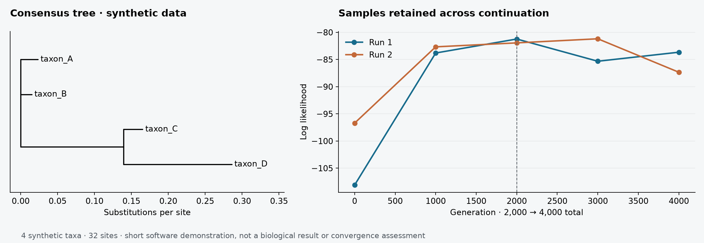

# Cladistica 0.2.0

Cladistica takes plant DNA markers from reviewed GenBank accessions or your own FASTA files to an aligned matrix and phylogenetic trees. It runs MUSCLE for alignment, IQ-TREE for maximum likelihood, and MrBayes for Bayesian inference. Every stage can also run separately.

[Download](https://github.com/yoneoka-katsuhiro/Cladistica/releases) · [日本語](README-ja.md) · [English manual](docs/MANUAL.en.md) · [日本語マニュアル](docs/MANUAL.ja.md) · [Changes](CHANGELOG.md)



*The supplied 32-base synthetic matrix was run for 2,000 generations, then extended to 4,000 using its checkpoint. The image shows actual program output. This short demonstration tests file continuity; it is not a biological result or evidence of MCMC convergence.*

## Download and run

Select a ZIP from [Releases](https://github.com/yoneoka-katsuhiro/Cladistica/releases), extract the entire folder, and open a terminal in that folder. Keep `_internal` beside the executable. These are command-line packages; they do not open a desktop window.

| Package | Platform | What is included |
| --- | --- | --- |
| `Cladistica-0.2.0-macOS-arm64.zip` | Apple Silicon Mac | CLI, Python runtime, examples, both manuals |
| `Cladistica-0.2.0-Windows-x64.zip` | Windows x64 | CLI, Python runtime, examples, both manuals |

The macOS package is not notarized; the Windows package is not Authenticode signed. The release page records the build and validation status of each asset. Automated Windows checks do not establish that every external-tool workflow has been tested on a physical Windows PC. Intel Macs can use the Python installation below.

**macOS:** `./cladistica --help`
**Windows PowerShell:** `.\cladistica.exe --help`

MUSCLE, IQ-TREE and MrBayes are **separate installations**. Set their paths using `--muscle`, `--iqtree`, and `--mrbayes`, or place their executables on `PATH`. The Python-only dry run needs none of these tools. See the [installation guide](docs/MANUAL.en.md#installation).

For a source installation, download or clone this repository, open its folder, and run:

```bash
python -m venv .venv
# macOS/Linux: source .venv/bin/activate
# Windows PowerShell: .venv\Scripts\Activate.ps1
python -m pip install .
cladistica --help
```

Python 3.10 or later is required for a source installation. There is no requirement to install this package from PyPI.

## A typical analysis

1. Use `survey` to collect GenBank candidates. Review specimen identity, vouchers, marker boundaries and coverage in `accession_all.csv`.
2. Save a curated `accession_selected.csv` with one row per sample and at most one accession per marker cell. Give every specimen a stable `sample_id` shared across loci.
3. Use `resume` to download those sequences, merge your marker FASTA files, align, concatenate and infer trees.
4. Inspect alignment QC, ML support, independent BI traces, effective sample size and convergence before interpreting a tree.

```bash
cladistica resume --concatenated-fasta examples/tiny.fasta --output demo_run --skip-ml --ngen 2000
cladistica resume-bi --bundle demo_run --output demo_extended --ngen 4000
```

Use `./cladistica` or `.\cladistica.exe` in place of `cladistica` when using a downloaded package. These two commands require MrBayes. For a dependency-free preview:

```bash
cladistica tree --input examples --output demo_preview --dry-run
```

## Bayesian runs now remain resumable

Version 0.2.0 retains the complete `BI_resume/` directory: checkpoint and backup, tree samples, parameter samples, diagnostics, analysis script, command logs and a hash manifest. Raw stages also remain under `_work/`, including after interruption.

`resume-bi` checks input integrity, sample identity, required files, the MrBayes version and the target generation. It copies the original run into a **new** output directory before using `append=yes`. `--ngen 4000000` means a total target of four million generations. The source bundle stays unchanged.

The older `resume` command starts a new analysis from sequence data; it does not continue MCMC. Old results containing only `BI.tre`, `BI.nex` and `.p` traces cannot reconstruct missing checkpoints or tree samples. See [BI recovery and extension](docs/MANUAL.en.md#bi-recovery-and-extension).

## Methods and scope

Cladistica extracts annotated CDS, tRNA, rRNA, intron and intergenic markers. It does not infer unannotated marker boundaries by sequence similarity. IQ-TREE uses partitioned `MFP+MERGE` model selection and standard nonparametric bootstrap. BI uses partitioned GTR+Gamma with explicit priors and chain settings in `BI.nex`; it does not automatically adopt IQ-TREE's selected models.

Defaults are starting settings, not a guarantee that a dataset is appropriate for concatenation or that an analysis converged. Outgroup inclusion does not automatically root the exported tree. The [manual](docs/MANUAL.en.md) explains sample identity, missing data, outputs and limitations.

## Development and citation

[Audit and validation](docs/AUDIT.md) · [Feature ideas](docs/ROADMAP.md) · [Build instructions](docs/DISTRIBUTION.md) · [Citation guidance](CITATIONS.md)

Cladistica is MIT licensed. Cite the public sequences and the external tools actually used. Development follows the small, testable changes, explicit inputs and reproducible outputs described in [ai-biocode-kata](https://github.com/dritoshi/ai-biocode-kata/tree/main/chapters).
